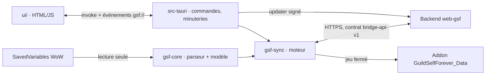

# Architecture

La forme technique macro : la stack, l'assemblage des parties et les décisions derrière. Pointe vers le code, ne le recopie pas.

## Stack

- Rust (workspace Cargo, version figée par `rust-toolchain.toml`) + Tauri v2 pour la fenêtre, le bundle NSIS et l'updater.
- Front en HTML/JS/CSS sans framework ni npm, servi tel quel depuis `ui/` (`withGlobalTauri`, API sur `window.__TAURI__`).
- Transverse : `tokio` (boucle de fond), `serde`/`serde_json`, `thiserror`.

## How it fits together

## Key decisions

- Toute la logique métier vit dans `gsf-core` et `gsf-sync`, sans dépendance Tauri : ils se compilent et se testent sous Linux. `src-tauri` reste fin (état, boucle de fond, commandes, updater) et ne contient aucune règle métier.
- Les SavedVariables de l'addon sont lues en lecture seule, jamais écrites. Le bridge n'écrit que l'addon séparé `GuildSelfForever_Data`, uniquement quand le jeu est fermé (sinon à la fermeture), par fichier temporaire puis renommage, et seulement si `version` change.
- Parseur Lua écrit à la main (sous-ensemble Lua 5.1 des SavedVariables) plutôt qu'un interpréteur embarqué : rien n'est exécuté ; un vrai Lua 5.1 (`mlua`) ne sert que d'oracle dans les tests.
- Les clés des SavedVariables ne sont pas des identités : la normalisation fusionne les profils, résout les alias et tolère les variations entre versions de l'addon ; un champ absent ou mal typé devient `None`, rien ne panique.
- Le contrat avec le site fait foi : l'original vit dans l'espace de travail privé du projet (partagé avec `web-gsf`) ; `docs/bridge-api-v1.md` en est la copie publique (sans noms de joueurs réels), à mettre à jour à chaque évolution du contrat. `GuildData` sérialisé (`crates/gsf-core/src/model/mod.rs`, `MODEL_VERSION`) en est la référence ; toute rupture = `MODEL_VERSION` incrémenté côté bridge et `v2` du contrat.
- Envoi idempotent : `snapshot_hash` = SHA-256 du JSON canonique de `guilds` ; un hash déjà accepté (`state.json`) n'est pas renvoyé. Erreurs temporaires (réseau, 5xx, pas de token, 426) → file d'attente bornée ; refus définitif (422, 413…) journalisé sans nouvel essai.
- Les filtres des bans (et, depuis le ban « personne » du contrat 2026-10-17, des `banned_identities`) reprennent exactement les règles de `GSF:LoadPushedData` de l'addon, car l'addon rejette tout le fichier au moindre champ invalide.
- Les plafonds documentés sur les listes venant des SavedVariables (`deaths`, `bridge_violations`, `member_identities`…) ne sont pas réappliqués côté bridge : l'addon les respecte avant d'écrire, et c'est son propre SavedVariables qu'on lit. Seules les données venant du site (`pushed.rs`, réseau non garanti) sont activement bornées et filtrées côté bridge.
- Étape 5 du bridge pour tous (contrat 2026-11-02 b) : les données poussées sont demandées avec `If-None-Match` (version déjà écrite, seulement si `Data.lua` existe partout et que rien n'attend la fermeture du jeu) et un `304` ne réécrit rien ; un bridge de membre simple (`SyncState::is_plain_member` : rôles sans `officer`/`admin`, pas une vigie, dernier `collector` reçu ≠ `true`, `pushed_collector` dans `state.json`) n'envoie de chaque guilde que les clés de preuve (`snapshot::MEMBER_GUILD_KEYS`, hash recalculé, filtre aussi appliqué aux envois en file) ; `collectorProofs` et `receivedViolations` sont écrits pour l'addon (collecteur prouvé, accusé de réception) ; `Violation.handed_to` (gsf-core) porte à qui une violation a été remise en jeu.
- « Je joue sur plusieurs ordinateurs » (contrat 2026-11-03, bridge 0.7.1) : case `config.audit_sync`, décochée par défaut. Cochée : `gsf-core` `model::baseline` lit les photos d'audit de l'addon (copie dédiée de chaque perso + `auditBaselineBackups` du compte, la plus récente par perso), `sync_all` les envoie à part (`POST /bridge/audit-baselines`, seulement si l'empreinte `state.audit_baselines_hash` change, renvoi chaque minute si le site ne répond pas), les données poussées sont demandées avec `audit_baselines=1` (au démarrage, à la connexion et chaque minute jeu fermé) et `auditBaselines` est écrit pour l'addon, chaque photo validée seule. Décochée : `DELETE /bridge/audit-baselines` redemandé chaque minute (`state.audit_forget_pending`) jusqu'à la réponse du site.
- `/played` dans l'audit (contrat 2026-11-03 c, bridge 0.7.3) : `AuditReport` lit `playedBefore`/`playedAfter`/`levelBefore`/`levelAfter` (omis du JSON si absents) ; les photos `model::baseline` portent `played`/`played_observed`/`level` hors `checksum`, nettoyés par `BaselineSnapshot::sanitize_played` (champ invalide écarté seul) et réécrits en `played`/`playedObserved`/`level` pour l'addon.
- Aucun verrou tenu pendant un appel réseau ou une attente disque (`engine.rs`).
- Code, commentaires et interface en français.
- Plans de travail (interconnexion, « bridge pour tous ») hors dépôt, dans l'espace de travail privé du projet.

## Gotchas

- Noms non ASCII (`Dävin-Abysses`, `Fumée-Ravine` dans les fixtures) : chemins natifs de bout en bout, jamais de reconstruction de chemin à partir d'un nom.
- Le client écrit les SavedVariables en plusieurs passes : attendre que taille et date soient stables sur deux lectures, relire en cas d'échec, puis replier sur `.bak` (`svread.rs`).
- Le registre WoW peut pointer un dossier de version : il est remonté à la racine (`normalize_install_root`).
- Fermer la fenêtre la cache seulement (icône près de l'horloge) : seul « Quitter » arrête la surveillance.
