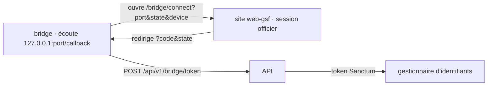

# Auth

Comment fonctionnent l'identité et l'accès : authentification et autorisation.

## Authentication

- Connexion navigateur + loopback (contrat §1, `crates/gsf-sync/src/auth.rs`) : le bridge n'a pas d'écran de login, l'officier s'authentifie sur le site.
- Enregistrement « vigie » sans compte (contrat « vigies », `register_if_needed` dans `engine.rs`) : tant qu'aucun token n'est stocké, le bridge s'enregistre seul auprès de `POST /api/v1/bridge/devices` avec un `device_id` (uuid, `config.json`) et un secret (48 car. `[A-Za-z0-9_-]`, gestionnaire d'identifiants, compte `device-secret`). Appelé au démarrage, toutes les 5 min et à chaque changement de SavedVariables. `device_secret_mismatch` → nouveau `device_id`+secret (l'ancien reste bloqué).

- Le `state` aléatoire est vérifié au retour ; le code est à usage unique et court.

## Authorization

- Deux genres de token, suivis par `state.token_kind` (`Officer`/`Vigie`) : officier (confiance totale) ou vigie (compte de service `vigies`, droits restreints côté site — jamais de rang, banque, demande). Une connexion officier remplace toujours un token vigie. `403` sur un token vigie (appareil coupé) → efface le token et repart en `RegistrationPending` (pas de reconnexion manuelle, juste le prochain cycle d'enregistrement).
- Token Sanctum avec les abilities `bridge:read` et `bridge:push`, réservé aux officiers et admins (le site renvoie `403` sinon) ; appliqué côté backend, le bridge ne fait qu'en tirer les conséquences.
- Le token part en `Authorization: Bearer` sur chaque route bridge, y compris la vérification et le téléchargement des mises à jour (`src-tauri/src/updater.rs`).
- `401`/`403` sur une route bridge → token effacé, reconnexion demandée. `426` (`bridge_outdated`) → phrase « Une mise à jour obligatoire est disponible. » et fenêtre de mise à jour sans « Plus tard », envois mis en file ; les routes de mise à jour ne sont jamais bloquées par la version minimale.

## Sessions

- Token rangé dans le gestionnaire d'identifiants Windows (`keyring`, service `fr.gs4ever.bridge`, compte `bridge-token`) ; trait `TokenStore` (`MemoryStore` en test). Secret d'appareil : même service, compte `device-secret` ; trait `DeviceSecretStore` (`MemoryDeviceSecretStore` en test).
- Repli (0.7.5, `secretfile.rs`) : si le gestionnaire refuse (« Platform secure storage failure: Windows error code 8 » sur certains PC), le secret va dans `token.protected` / `device-secret.protected` du dossier de données, chiffré par DPAPI pour le seul compte Windows (0600 ailleurs) ; le coffre reste prioritaire et le fichier est effacé dès qu'il accepte de nouveau.
- Pas de rafraîchissement : un token refusé impose une nouvelle connexion. Changer l'adresse du site dans « Réglages » déconnecte.
