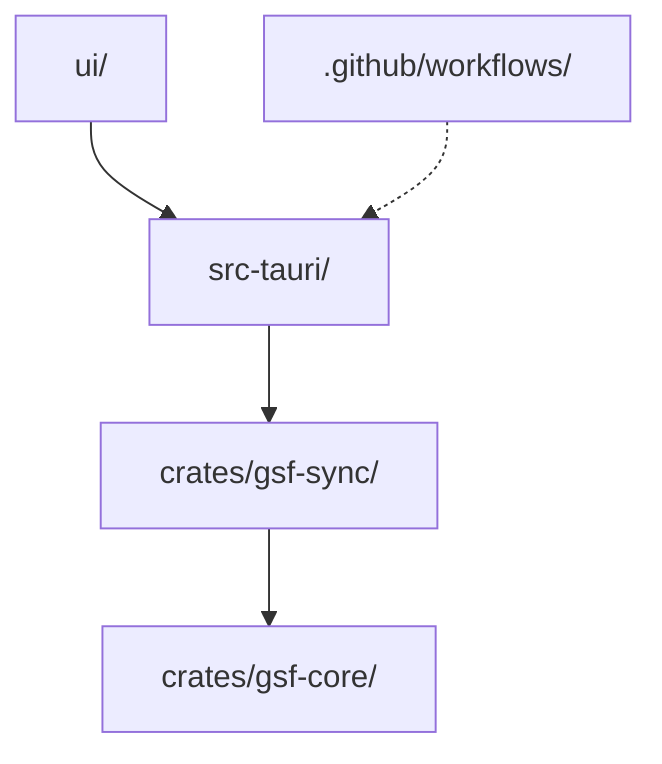

# Codebase Map

La disposition macro : les zones de premier niveau et ce que chacune contient. Une carte pour naviguer, pas l'arbre complet.

## Areas

- `crates/gsf-core` : parseur des SavedVariables (`src/sv`) et modèle normalisé par guilde (`src/model`) ; fixtures réelles du client Forever dans `tests/fixtures`.
- `crates/gsf-sync` : moteur du bridge (découverte WoW, lecture stable, snapshot, client HTTPS, connexion, file, données poussées, surveillance, orchestration dans `engine.rs`).
- `src-tauri` : application Tauri (état partagé, boucle de fond et minuteries dans `lib.rs`, commandes UI dans `commands.rs`, updater dans `updater.rs`, config `tauri.conf.json`).
- `ui` : page unique HTML/JS/CSS en français.
- `.github/workflows` : `ci.yml` (contrôles + build Windows) et `release.yml` (publication signée).

## Entry points

- `src-tauri/src/main.rs` → `gsf_bridge_lib::run()` (`src-tauri/src/lib.rs`).
- `crates/gsf-sync/src/engine.rs` : `Engine`, seule surface appelée par l'application.
- `cargo run -p gsf-core --example dump -- compte.lua perso.lua` : affiche le modèle normalisé en JSON.

## Packages

- `gsf-core` : logique pure, aucune E/S réseau.
- `gsf-sync` : dépend de `gsf-core` ; toutes les E/S (disque, réseau, keyring, processus) derrière des traits injectables (`TokenStore`, `GameDetector`).
- `gsf-bridge` (`src-tauri`, lib `gsf_bridge_lib`) : dépend de `gsf-sync` ; seul crate qui tire Tauri.
