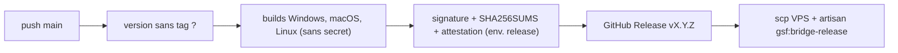

# Deployment

Où le projet tourne et comment il est livré : CI/CD, environnements et publication.

## Pipeline

- GitHub Actions. `ci.yml` à chaque push sur `main` et PR : `secrets-scan` (gitleaks, `.gitleaks.toml`), `linux-core` (fmt, clippy `-D warnings`, tests de `gsf-core`/`gsf-sync`) puis `windows-build` (tests, clippy de l'app, installeur NSIS non signé en artefact).
- `release.yml` à chaque push sur `main` : publie seulement si la version n'a pas encore de tag `vX.Y.Z`. Builds sans secret ni cache, puis job `sign` (environnement protégé `release`, seule la CLI Tauri voit la clé), `SHA256SUMS` et attestation de build (dépôt public seulement). Lancement manuel = essai à blanc (`dry_run`) par défaut.
- Durcissement : actions figées par empreinte de commit (commentaire = version), Rust figé (`rust-toolchain.toml`), CLI Tauri figée (`TAURI_CLI_VERSION`), `persist-credentials: false`. Monter une version = changer l'empreinte et le commentaire ensemble.

## Environments

- Production : site `https://gsforever.com` (adresse par défaut, endpoint updater dans `tauri.conf.json`).
- Dev : l'adresse n'est plus réglable dans l'application (0.3.1+) : changer `DEFAULT_BASE_URL` (`crates/gsf-sync/src/api.rs`) et l'endpoint updater pour viser `http://localhost:8000`, avec `dangerousInsecureTransportProtocol`.
- Poste de dev Linux/WSL : seuls `gsf-core` et `gsf-sync` se compilent et se testent (bibliothèques système Tauri absentes) ; le vrai build Windows se fait en CI.

## Release

- Publier = monter `version` dans `[workspace.package]` de `Cargo.toml` puis fusionner sur `main` (`tauri.conf.json` n'a pas de `version` et reprend celle du workspace). `v0.1.0` est publiée.
- Les notes de release et `--notes` côté site viennent du message du dernier commit : le soigner.
- Étape VPS sautée proprement si les secrets `DEPLOY_HOST`/`DEPLOY_USER`/`DEPLOY_SSH_KEY` manquent ; l'artisan tourne dans `/srv/gsf-web/current` (`web-gsf`).
- Clé de signature de l'updater : privée dans `~/.tauri/gsf-bridge.key` (+ `gsf-bridge.password`) sur le poste de dev, et secrets GitHub `TAURI_SIGNING_PRIVATE_KEY` / `TAURI_SIGNING_PRIVATE_KEY_PASSWORD` sur `GuildSelfForever/gsf-bridge` (à ranger dans l'environnement protégé `release`). **À sauvegarder hors de la machine** : la perdre interdit toute mise à jour des bridges installés sans réinstallation manuelle. Jamais commitée (`*.key` ignoré) ; la clé publique est dans `plugins.updater.pubkey`.
- Pas de retour arrière automatisé : corriger en publiant une version supérieure.
- Pas de signature de code Windows (SmartScreen) : seul le premier `setup.exe`, téléchargé depuis l'admin du site, déclenche l'avertissement.

## Monitoring

- Aucun outil : journal en mémoire affiché dans l'application (50 entrées) et état des envois côté site.
